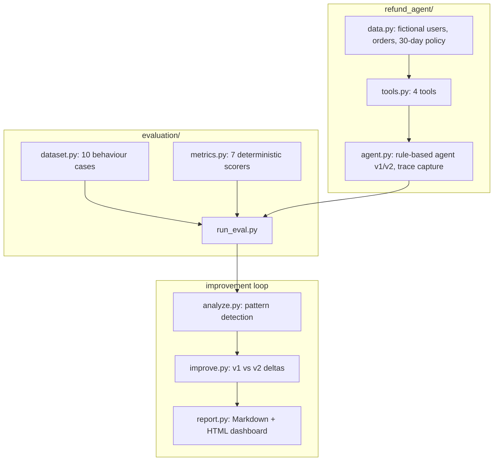

# Jagadish-agent-eval-studio

**End-to-end agent evaluation: build the agent, measure it on 7 metrics, fix what the metrics find, prove the fix.** A refund agent for a fictional outdoor store, a 10-case behaviour dataset, seven deterministic offline metrics, and a measured v1 → v2 improvement loop. 87 tests, stdlib only, no API keys, runs in under a second.

> Personal learning and portfolio project. Everything runs offline on
> synthetic, fictional data. Nothing is deployed. Numbers below come from
> real runs in this repo.

## Recruiter summary

- Shows how to put an AI agent under test properly: behaviour cases that pin expected *tools and arguments* (not just answers), 7 metrics across outcome/path/behaviour, and a failure-analysis → fix → re-measure loop.
- Real result: the harness caught 2 flaws happy-path tests missed (wrong messaging for unknown users; a wasted date lookup), and the before/after comparison proves both fixes with zero regressions.
- Deterministic and CI-friendly: 87 tests, stdlib only, ~0.2s. LLM-judge seams documented for production use.

## Architecture



## How it works

1. **Agent.** `RefundAgent` handles a refund request: parse the username and items, look up the order, check the 30-day policy per item, calculate the refund for eligible items only, and issue a *ticket* for human review. Money never moves in code — payout stays human-in-the-loop by design.
2. **Dataset.** 10 behaviour cases cover the full scenario space: valid refund, partial refund, expired window, mixed eligibility, fraud (item never purchased), unknown user, missing username, info-only question, and more. Each case pins the expected conclusion phrases, tools, and arguments.
3. **Metrics.** All 7 run on every trace: task completion, step efficiency, plan adherence, plan quality, tool correctness, argument correctness, answer correctness. Each returns a 0–1 score, pass/fail vs a threshold, and a human-readable reason.
4. **Improvement loop.** v1 ships with two known flaws; `analyze.py` detects the patterns, v2 fixes them, `improve.py` proves the delta with no regressions.

## Real run output

`python3 demos/demo_run.py` (v2, 10 cases):

| Metric | Avg score | Pass rate |
|---|---|---|
| task_completion | 1.00 | 100% |
| step_efficiency | 1.00 | 100% |
| plan_adherence | 1.00 | 100% |
| plan_quality | 1.00 | 100% |
| tool_correctness | 1.00 | 100% |
| argument_correctness | 1.00 | 100% |
| answer_correctness | 1.00 | 100% |

Before/after (v1 → v2) — the two fixes, measured:

| Metric | v1 avg | v2 avg | Delta |
|---|---|---|---|
| step_efficiency | 0.85 | 1.00 | +0.15 |
| answer_correctness | 0.90 | 1.00 | +0.10 |
| task_completion | 0.90 | 1.00 | +0.10 |
| tool_correctness | 0.92 | 1.00 | +0.08 |

No regressions on any metric. See [knowledge/04-improvement-loop.md](knowledge/04-improvement-loop.md) for the full story.

## Example: what a behaviour case looks like

```python
BehaviorCase(
    case_id="fraud-never-purchased",
    input="I am u-1003, I would like a refund for the running sneakers.",
    expected_conclusion=("no refund will be issued", "never purchased"),
    expected_tools=("get_order_details", "check_refund_eligibility"),
    expected_arguments={
        "check_refund_eligibility": {"username": "u-1003",
                                     "items": ["running sneakers"]},
    },
)
```

And what the agent returns (structured, with trace):

```python
response.answer
# "No refund will be issued. running sneakers: was never purchased."
response.conversation_continue  # False
response.tool_names()
# ["get_order_details", "check_refund_eligibility"]
```

## How to run

```bash
# Full test suite (87 tests, ~0.2s, stdlib only)
python3 -m pytest tests/ -q

# End-to-end demo with Markdown dashboard
python3 demos/demo_run.py

# Plus a single-file HTML dashboard
python3 demos/demo_run.py --html report.html
```

## Guardrails and security controls

- **Money never moves.** `process_return_request` issues a ticket flagged `human_review_before_payout`. There is no payout code path, by design. A test asserts the ticket carries the human-review flag.
- **Fraud probes are first-class cases.** Never-purchased items are denied with reasons; the dataset includes a fraud case and the agent never refunds unpurchased goods (tested).
- **Least-privilege tools.** Each tool does one thing; the agent cannot invent capabilities. Unknown users get asked for a valid username — no data leaks.
- **Deterministic and offline.** No network, no API keys, no secrets. Fixed evaluation date keeps runs reproducible.

## Limitations and known failures

- **The agent is rule-based, not an LLM.** This is deliberate: it makes every metric unit-testable and the suite CI-safe. A production port would wrap an LLM to emit the same trace format; the seams are marked `LLM SEAM` in the code and documented in `docs/implementation-guide.md`.
- **Metrics are heuristics, not judges.** They measure structure (tool sets, order, phrase presence). Nuanced grading (tone, plan creativity) needs the documented LLM-judge seams; the heuristics are the free baseline to calibrate against.
- **10 cases is a regression set, not a quality claim.** It proves the harness works and the loop closes; it does not prove a production agent is good.
- **Thresholds (0.8) are illustrative.** Tune per metric and per risk level for real use.

## Built / Written-not-run / Planned

| Item | Status |
|---|---|
| Refund agent (v1/v2) with trace capture | Built, tested |
| 10-case behaviour dataset | Built, tested |
| 7 deterministic metrics | Built, tested |
| Failure analysis + pattern detection | Built, tested |
| v1→v2 improvement comparison | Built, tested (deltas asserted) |
| Markdown + HTML dashboards | Built (demo-run verified) |
| LLM-judge integrations | Written-not-run (seams documented, no live calls) |
| Larger dataset / real LLM agent port | Planned |

## Docs

- [knowledge/](knowledge/) — why evals matter, the seven metrics, architecture, the improvement loop
- [docs/implementation-guide.md](docs/implementation-guide.md) — adopt this harness for your own agent
- [docs/interview-points.md](docs/interview-points.md) — the 30-second pitch and likely questions

## Related

- `Jagadish-llm-evals-observability` — the broader eval/observability library (judges, bias probes, cost analytics); this repo is the end-to-end applied companion.
- `Jagadish-agent-feedback-loop` — production feedback → golden cases → regression gates, the production sibling of the improvement loop here.
