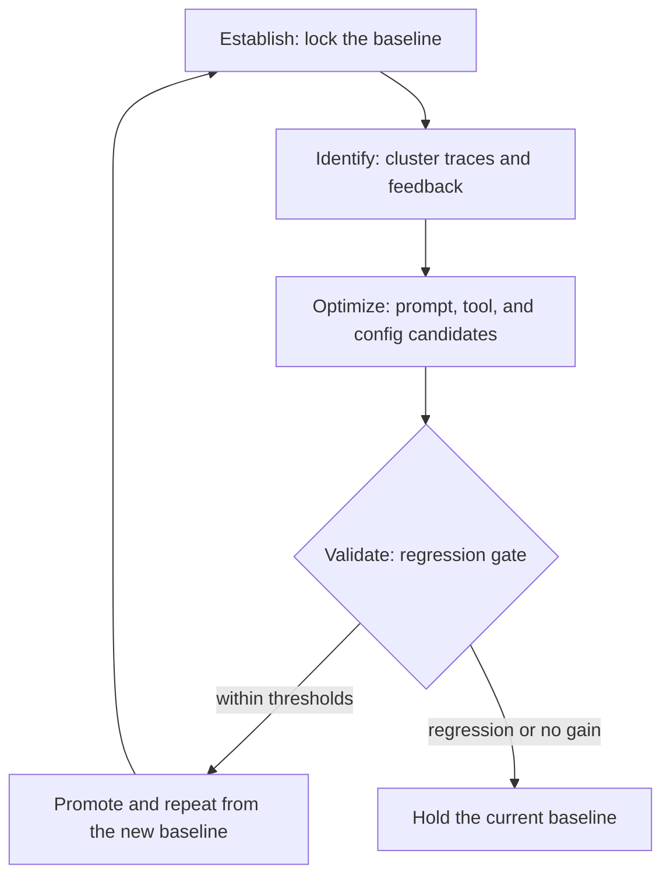

# Continuous improvement

Offline loop modeled on the four steps in the Foundry continuous-improvement
write-up (November 2026):

<https://azure.microsoft.com/en-us/blog/continuous-improvement-comes-to-microsoft-foundry/>

Establish a baseline, identify recurring problems from traces and feedback,
optimize with a concrete change, then validate against that baseline before
anything is promoted. This repo does not call that product. It runs the same
shape on synthetic traces, synthetic feedback, and the deterministic eval
harness already in `evaluation/`. Where a sentence describes the hosted
product rather than this code, it is marked **[verify]**.



## Steps in this repo

### Establish

`establish_baseline` runs `run_all` and `summarize` for the current agent
version and freezes those scores, the golden case ids, and the mean latency
and token counts from the synthetic traffic for that version. The behaviour
cases are the locked dataset. The write-up's rubric evaluators, generated
per-case rubrics, and named golden-dataset feature are [verify].

### Identify

`identify_problems` groups synthetic traces by feedback labels and by two
trace signatures that match `analyze.detect_patterns`: a wasted `get_today`
call, and unknown-username copy that talks about purchase history. Clusters
are ranked by how many traces they contain, so the most common problem is
first. A label seen once stays below the frequency cutoff. Patterns found
by the eval harness are attached as extra evidence, and a pattern with no
production traces still surfaces from the eval cases. The write-up's
insights product, its release status, and connectors for other agent
frameworks are [verify].

### Optimize

`optimize` turns each cluster above the cutoff into a candidate:

- **Prompt.** Instruction text for the unknown-username reply.
- **Tool.** Drop `get_today` when eligibility already decided the request.
- **Config.** A smaller mock model, and a separate token cap.

Prompt-only and tool-only candidates keep the baseline case results and
copy the targeted metric scores from a real `run_all("v2")`. The combined
candidate is that v2 run. The smaller-model candidate applies a fixed
quality penalty so a cheaper change that gets worse fails the gate. The
token cap leaves scores unchanged and trims the synthetic token count.
Skill optimization, training model weights, and a model router with a
published savings figure are [verify] and are not implemented here.

### Validate and repeat

`validate` fails a candidate when any metric average, or any single case,
drops by more than the regression threshold (default 0: any drop fails).
The per-case check goes through `improve.case_regressions`, so a gain in
the average cannot hide one case that got worse. Prompt and tool
candidates must also improve a targeted metric by at least
`min_improvement` (default 0.05). Config candidates must hold quality and
reduce tokens or latency.

The gate scores the candidate's case results. Averages printed on the
candidate cannot talk the gate into a pass.

`recommend` names the passing candidate with the largest quality gain,
then the largest token saving, then the largest latency saving. That is
a recommendation, not a ship decision. `run_loop(apply=False)` leaves the
baseline in place. `apply=True` promotes only a candidate whose gate
passed, and refuses a failed gate if called directly. The promoted
version is the next baseline: the combined fix adopts agent v2, and a
later pass will not propose the same change id again.

The write-up's statistical tests on live comparisons are [verify]. These
scorers are deterministic, so the gate is a fixed threshold plus a
minimum effect size, not a significance test. Sampling live traffic,
scheduled red-team scans, and release-pipeline integrations described in
the write-up are [verify] and are not wired up here.

## How to run

```bash
python3 scripts/continuous_summary.py
python3 -m pytest -q tests/test_continuous.py
```

`scripts/continuous_summary.py` prints one held pass (apply stays off).
The README embeds that output, and CI fails if it drifts.

## What this mock will not claim

- The traces, ratings, and notes are written in `evaluation/continuous.py`.
  They are not a sample of live traffic.
- Latency and token deltas are arithmetic on those traces: drop the mocked
  cost of `get_today`, add a few tokens for a longer instruction, or scale
  the totals. They are not measurements from a model host.
- Partial candidates reuse baseline traces and substitute scores for the
  metrics they target. Only the combined candidate is a full second agent
  run. When that candidate is promoted, the next baseline recomputes
  latency and tokens from the v2 synthetic traces rather than from the
  pre-promotion estimate.
- Nothing here trains weights, calls a model, or changes the agent unless
  the caller passes `apply=True` and the gate has passed.
