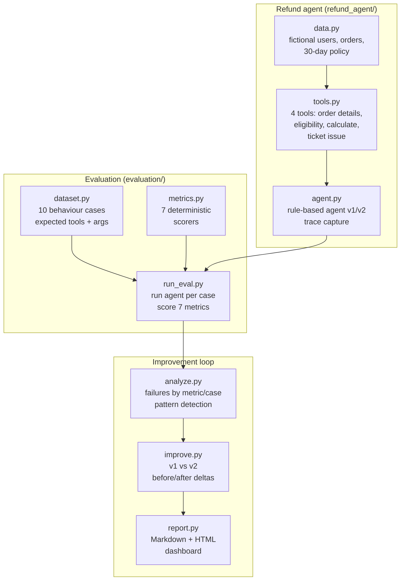

# 03 — Architecture

## Data flow

1. `dataset.py` defines 10 behaviour cases: input text plus expected
   conclusion phrases, expected tools, and expected arguments.
2. `run_eval.py` feeds each input to the agent, captures the trace
   (tool name, arguments, reasoning per step), and scores all 7 metrics.
3. `analyze.py` aggregates failures and matches them against known
   failure patterns (e.g. unnecessary date lookups).
4. `improve.py` runs both agent versions and computes per-metric deltas,
   proving fixes helped and nothing regressed.
5. `report.py` renders the Markdown and HTML dashboards.

## Key design decisions

- **Deterministic agent, not an LLM.** Rule-based behaviour means every
  run is reproducible and every metric is unit-testable. The agent
  mirrors a tool-calling LLM agent's structure (parse → tools → trace →
  structured response) so the eval harness ports directly.
- **Behaviour cases, not just Q&A.** Expected tools and arguments are
  first-class: they are what let trajectory metrics say anything.
- **Money never moves.** `process_return_request` re-validates its inputs
  and files a ticket in `review.py`, where only a named human (not the
  agent, not the customer) can approve it, once. Tests cover each rule.
- **Heuristics first, LLM judges as an option.** Deterministic scorers
  run in CI for free; `judge` callables are the seam for LLM grading.
